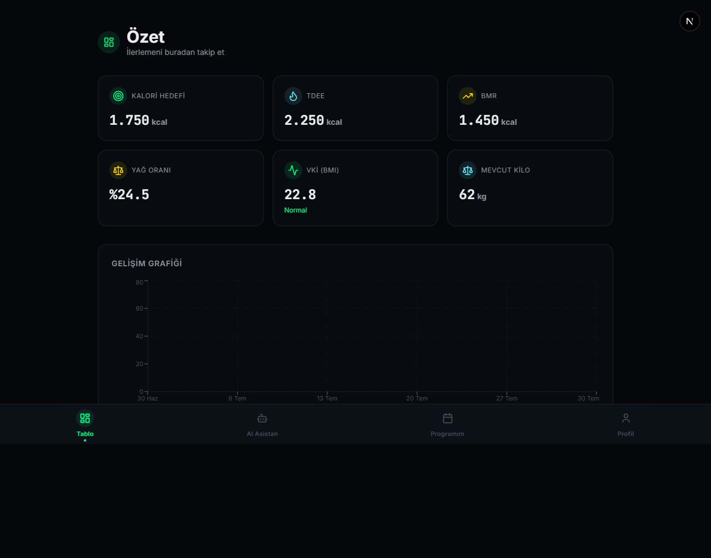
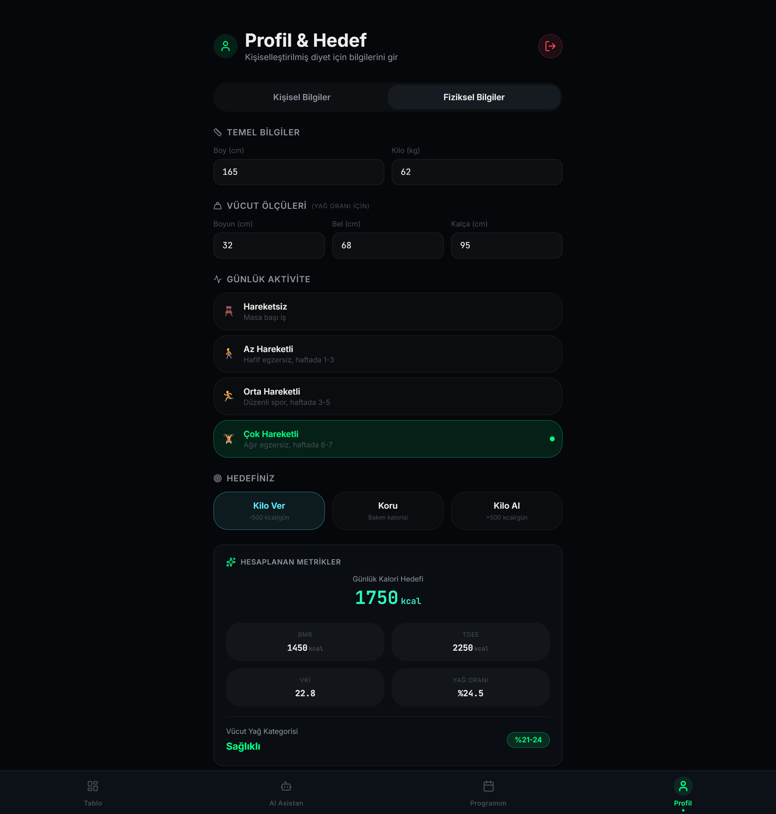
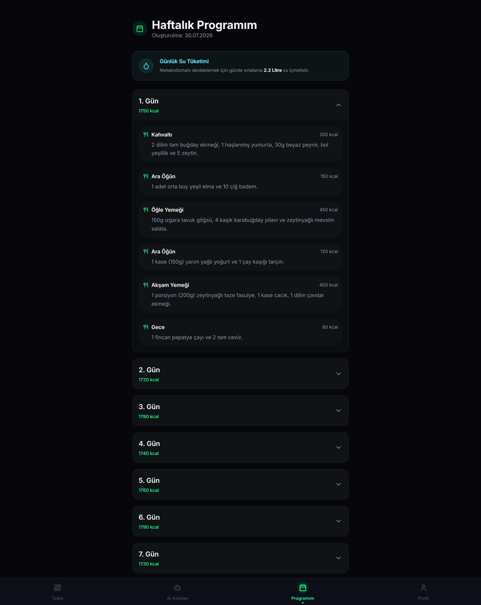
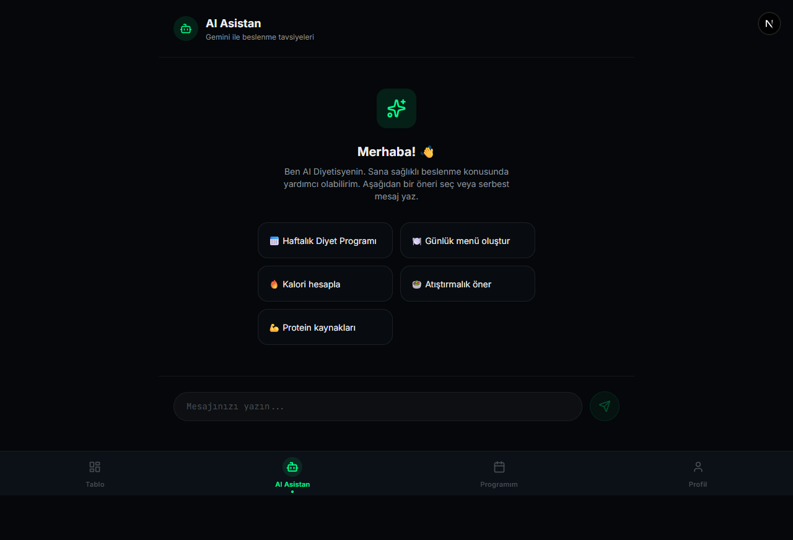

# AI Diyet Asistanı

Yapay zekâ destekli kişisel beslenme takip uygulaması. Kullanıcının vücut ölçülerinden
BMR/TDEE/BMI ve yağ oranını hesaplar, hedefe göre günlük kalori bütçesi çıkarır ve
Google Gemini ile haftalık diyet programı üretir.

**Tek çekirdek, iki istemci:** iş mantığı `shared/` içinde platform-bağımsız yazıldı;
Expo (React Native) ve Next.js uygulamaları aynı store'u, aynı hesaplamaları ve aynı
servisleri kullanıyor.

---

## Ekranlar

| Özet | Profil & Hedef |
|---|---|
|  |  |

| Diyet Programı | AI Asistan |
|---|---|
|  |  |

> Görsellerdeki değerler örnek (mock) verilerdir.

---

## Özellikler

- **Metrik hesaplama** — US Navy yağ oranı, Mifflin-St Jeor BMR, aktivite katsayılı
  TDEE, BMI ve kategori etiketleri
- **Güvenli kalori hedefi** — hedefe göre açık/fazla verirken cinsiyete özel alt sınır
  uygulanır (kadın 1200, erkek 1500 kcal); sınıra takıldığında arayüz kullanıcıyı uyarır
- **Haftalık AI diyet planı** — Gemini ile 7 günlük, öğün bazlı program; kullanıcı
  serbest metinle ("kırmızı et olmasın") planı revize edebilir
- **AI sohbet** — beslenme soruları için asistan, hazır öneri kısayollarıyla
- **Alternatif yemek önerisi** — plandaki bir öğünün yerine benzer kalorili öneri
- **İlerleme takibi** — günlük kilo/yağ oranı kaydı, grafik, su takibi
- **Kimlik doğrulama & senkronizasyon** — Firebase Auth + Firestore; profil ve kilo
  geçmişi buluta yazılır, cihaz değişse de korunur

---

## Mimari

```
shared/                     ← platform-agnostik çekirdek (her iki istemci de kullanır)
  types/                      ortak tipler
  store/                      Zustand store factory'leri (storage dışarıdan enjekte edilir)
    useDietStore.ts             createDietStore(storage)
    bindAuthToDietStore.ts      auth ↔ diet bağlama, çıkışta temizleme
  services/                   firebaseConfig, authService, firestoreService, geminiService
  utils/
    calculations.ts             BMR / TDEE / BMI / yağ oranı / kalori hedefi
    validation.ts               LLM çıktısı için şema doğrulama
  theme/                      renk, tipografi, boşluk token'ları

src/                        ← Expo / React Native (StyleSheet + React Navigation)
  store/stores.ts             factory'yi AsyncStorage ile kurar
  screens/ components/ navigation/

web-frontend/               ← Next.js 16 (App Router, Tailwind v4)
  src/lib/stores.ts           factory'yi localStorage ile kurar
  src/app/api/gemini/route.ts TEK Gemini çıkışı — anahtar yalnızca burada, sunucu tarafında
  src/app/                    /, /profile, /plan, /ai, /login, /register
```

### Neden `shared/`

Store bağlama, storage temizleme, doğrulama ve hesaplama mantığı tek yerde. Aynı
düzeltmeyi iki kez yapmak zorunda kalmamak için: bir zamanlar mobil ve web store'ları
ayrı yazılmıştı ve çıkışta storage temizleme yalnızca web'e uygulanmıştı — ortak
kullanılan bir telefonda önceki kullanıcının sağlık verisi kalıyordu.

> `@shared` alias'ı dört yerde ayrı ayrı tanımlı: `tsconfig.json`, `babel.config.js`,
> `metro.config.js`, `web-frontend/next.config.ts`. **Birini değiştirirken dördünü de
> kontrol edin.**

### Gemini çağrıları neden sunucudan geçiyor

Gemini API anahtarı istemci paketine asla girmez. Mobil uygulama da dahil olmak üzere
tüm AI çağrıları `web-frontend/src/app/api/gemini/route.ts` üzerinden yapılır:

```
Expo / Next.js istemci  →  /api/gemini  →  Gemini
                            (GEMINI_API_KEY yalnızca burada)
```

Route ayrıca sistem prompt'unu istemciden almaz (kendi sabitini kullanır), sohbet
geçmişini son 20 mesajla sınırlar, model çıktısını `shared/utils/validation.ts` ile
şema doğrulamasından geçirir ve ham model hatalarını istemciye sızdırmaz.

---

## Teknoloji

| Katman | Kullanılan |
|---|---|
| Mobil | Expo ~57, React Native 0.86, React Navigation 7 |
| Web | Next.js 16 (App Router, Turbopack), Tailwind CSS v4, Recharts |
| Ortak | TypeScript, Zustand 5 (persist), Firebase 11 (Auth + Firestore) |
| AI | Google Gemini (`@google/generative-ai`) |

---

## Kurulum

### Gereksinimler

- Node.js 20+
- Bir Firebase projesi (Authentication + Cloud Firestore etkin)
- Google AI Studio'dan bir Gemini API anahtarı

### 1. Depoyu klonlayın ve bağımlılıkları kurun

```bash
git clone <repo-url> && cd ai-diyet-asistani
npm install
npm --prefix web-frontend install
```

### 2. Ortam değişkenleri

Kökte `.env.example`'ı `.env` olarak kopyalayın ve Firebase istemci değerlerini doldurun:

```bash
cp .env.example .env
```

```env
EXPO_PUBLIC_FIREBASE_API_KEY=...
EXPO_PUBLIC_FIREBASE_AUTH_DOMAIN=...
EXPO_PUBLIC_FIREBASE_PROJECT_ID=...
EXPO_PUBLIC_FIREBASE_STORAGE_BUCKET=...
EXPO_PUBLIC_FIREBASE_MESSAGING_SENDER_ID=...
EXPO_PUBLIC_FIREBASE_APP_ID=...

# Gemini çağrılarının gideceği adres. Mobil derleme için ZORUNLU —
# boş bırakılırsa APK localhost'a (telefonun kendisine) istek atar.
EXPO_PUBLIC_API_URL=https://ornek-dagitim.vercel.app
```

Ardından `web-frontend/.env.local` dosyasını oluşturun:

```env
GEMINI_API_KEY=...                      # sunucu tarafı — asla NEXT_PUBLIC_ öneki almaz
NEXT_PUBLIC_FIREBASE_API_KEY=...
NEXT_PUBLIC_FIREBASE_AUTH_DOMAIN=...
NEXT_PUBLIC_FIREBASE_PROJECT_ID=...
NEXT_PUBLIC_FIREBASE_STORAGE_BUCKET=...
NEXT_PUBLIC_FIREBASE_MESSAGING_SENDER_ID=...
NEXT_PUBLIC_FIREBASE_APP_ID=...
```

> Firebase **istemci** anahtarlarının herkese açık olması normaldir; erişim kontrolü
> API anahtarıyla değil [`firestore.rules`](firestore.rules) ile sağlanır.
> `GEMINI_API_KEY` ise gerçek bir sırdır — `NEXT_PUBLIC_` / `EXPO_PUBLIC_` öneki
> **kullanmayın**, o önek anahtarı istemci paketine gömer.

### 3. Firestore kurallarını yayınlayın

```bash
firebase deploy --only firestore:rules
```

### 4. Çalıştırın

```bash
npm --prefix web-frontend run dev   # web  → http://localhost:3000
npm run start                       # mobil → Expo Go / geliştirme derlemesi
```

Mobil taraf AI özellikleri için web sunucusuna ihtiyaç duyar: `EXPO_PUBLIC_API_URL`
çalışan bir Next.js dağıtımını (veya yerel geliştirmede makinenizin LAN adresini)
göstermelidir.

---

## Doğrulama

Proje iki ayrı TypeScript projesinden oluşur; **ikisini de** kontrol edin:

```bash
npm run typecheck                       # kök (App.tsx, src/, shared/)
npm --prefix web-frontend run typecheck # web-frontend
```

Web tarafı için ek olarak:

```bash
npm --prefix web-frontend run lint
npm --prefix web-frontend run build
```

---

## Güvenlik notları

- Sağlık verileri (kilo, boy, yağ oranı, diyet planı) Firestore'da `users/{uid}` altında
  tutulur. [`firestore.rules`](firestore.rules) sahiplik kuralı uygular
  (`request.auth.uid == uid`); tanımsız yollar varsayılan olarak kapalıdır.
- Çıkış yapıldığında hem store sıfırlanır hem kalıcı depolama (`AsyncStorage` /
  `localStorage`) temizlenir — ortak kullanılan cihazda önceki kullanıcının verisi kalmaz.
- LLM çıktısı `JSON.parse` ile "doğrulanmış" sayılmaz; `shared/utils/validation.ts`
  şema kontrolü yapar, başarısızlıkta route 502 döner.
- Kalori hedefi cinsiyete özel alt sınırın altına inemez.

---

## Bilinen eksikler

- Otomatik test ve CI yok (hesaplama fonksiyonları saf ve test edilmeye hazır)
- Web tarafında ESLint hataları mevcut (çoğunlukla `set-state-in-effect` ve `any`)
- NativeWind kurulu ama mobil ekranların büyük kısmı `StyleSheet` kullanıyor
- `react` sürümleri iki tarafta birebir aynı değil (19.2.3 / 19.2.4)
- `@google/generative-ai` Google'ın eski SDK'sı; güncel paket `@google/genai`

Ayrıntılı teknik değerlendirme: [`docs/PROJE-ANALIZ-RAPORU.md`](docs/PROJE-ANALIZ-RAPORU.md)

---

## Lisans

[MIT](LICENSE) © Enes Karaçam
